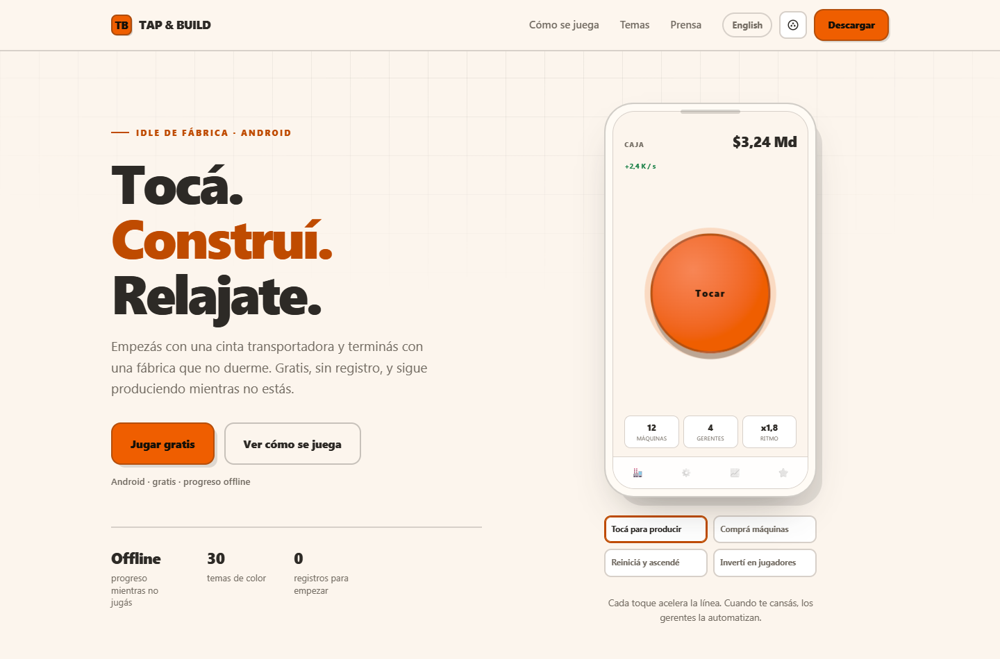

# Tap & Build — web

Sitio oficial de **Tap & Build: Idle Factory Tycoon** (Android).
Astro estático, cinco idiomas, y un sistema de temas que sale del código del juego.



```
npm install
npm run dev              # http://localhost:4321
npm run build            # valida contraste y genera dist/
npm run sync:themes      # re-extrae las paletas desde el repo del juego
npm run smoke            # prueba las interacciones con Chrome real
```

## La idea

Cuatro reglas, y todo lo demás sale de ahí:

1. **Los colores no se escriben a mano.** Salen de `../tap-and-build/src/constants/theme.ts`
   vía `npm run sync:themes`, y llegan al CSS como tokens semánticos.
2. **El contraste se valida en el build.** `scripts/check-contrast.mjs` falla si un tema no
   llega a AA en texto, texto suave, botón, acción, mercado o botón de compra.
3. **El copy vive en JSON.** `src/data/copy/{es,en}.json`. Cambiar un titular es editar un
   string, no un HTML.
4. **Todo link a Play lleva referrer.** Si no, no se puede saber qué trajo instalaciones.

## Estructura

```
scripts/
  sync-themes.mjs      # extrae las 8 paletas del juego -> src/data/themes.json
  check-contrast.mjs   # valida AA y emite src/styles/themes.css
  smoke.mjs            # interacciones (switcher, popover, tabs) en Chrome headless
  make-og.py           # genera las imágenes Open Graph en public/og/
  overflow.mjs         # detecta desbordes horizontales en 360/414/768
src/
  data/
    site.json          # nombre, paquete, URL de la store
    locales.json       # idiomas del sitio
    routes.json        # ruta de cada página en cada idioma
    themes.json        # GENERADO: 8 temas + cuántos hay en el juego
    copy/{es,en}.json  # todo el texto del sitio
  lib/
    tokens.mjs         # color -> tokens semánticos (onPrimary, action, up/down)
    links.mjs          # storeLink() con referrer, storeIntent() para Android
  styles/
    global.css         # sistema visual (ningún color hardcodeado)
    themes.css         # GENERADO: una clase por tema
  content/legal/       # privacy, terms y data-deletion (heredados, ver abajo)
  components/          # Nav, Device (tour), ThemeGallery, PressBody, Footer
  pages/
    [...slug].astro    # las 25 páginas: 5 idiomas x 5 tipos, desde routes.json
    go.astro           # /go  link-in-bio + intent:// + código de invitación
public/
  _headers             # seguridad y caché (Cloudflare Pages)
  _redirects           # /invite/* -> /go/ y 301 de las URLs viejas
  og.png               # imagen para compartir
```

## Temas

`sync-themes.mjs` toma 8 de los 30 temas del juego, elegidos por distancia perceptual
(ΔE en Lab), y los mapea a tokens:

| token | de dónde sale |
|---|---|
| `--bg` `--surface` `--surface-2` | `background`, `backgroundCard`, `surface` |
| `--text` `--muted` | `text` y `textMuted`, corregidos hasta 7:1 y 4.5:1 |
| `--primary` `--on-primary` | `primary` y la tinta de más contraste sobre él |
| `--action` | `primary` empujado hasta 4.5:1 sobre el fondo |
| `--up` `--on-up` `--down` | verde/rojo accesibles y su tinta |

El default es **Cream Vanilla** (el default real del juego). `?theme=slug` fuerza un tema.

## Idiomas

EN (raíz), ES, DE, RU y PT-BR. Las rutas viven en `src/data/routes.json`: agregar un idioma
es sumar su código a `locales.json`, su entrada en `routes.json` y un `src/data/copy/xx.json`.
El hreflang, el canonical y el selector de idioma salen de ahí solos.

DE tiene las legales traducidas. RU y PT las muestran en inglés con un aviso de cuál es la
versión vinculante (pendiente de traducir si el mercado lo justifica).

Para agregar un tema: sumarlo a `SELECTION` en `sync-themes.mjs`, correr
`npm run sync:themes && npm run check`, y si pasa AA aparece solo en el switcher y la galería.

## Pendientes antes de publicar

- [ ] **App Links.** El manifest del juego ya declara `autoVerify` para `/invite/*`, y
      `public/.well-known/assetlinks.json` ya está acá (no perderlo en el deploy). Falta
      confirmar que la huella SHA-256 sea la de **Play App Signing**, no la de upload.
- [ ] **OG images**: generadas con `npm run og` (`scripts/make-og.py`). Cuando esté el arte
      nuevo, conviene regenerarlas con la misma tipografía del sitio.
- [ ] **Prensa**: cuando haya capturas nuevas, van a `public/press/` y se muestran en la página.

## Deploy

Cloudflare Pages, build `npm run build`, output `dist`. `_headers` y `_redirects` se aplican
solo ahí (en GitHub Pages se ignoran).
